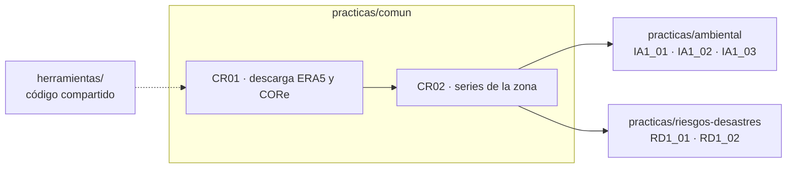

# cambio-climatico-espam

Prácticas reproducibles de cambio climático de la ESPAM MFL en Google Colab: reanálisis, datos de estaciones, modelos climáticos y escenarios de cambio climático aplicados al Ecuador.

Docente: Cristian Omar Paliz Acosta, MSc. · ORCID 0000-0002-1738-8131

## Estructura

```
practicas/            cuadernos de Colab
  comun/                COMÚN a las dos carreras: obtención y preparación de datos
    reanalisis/           CR01 descarga ERA5 y CORe · CR02 series de la zona
    estaciones/           formato común de datos de estación
    bitacora/             bitácora del evento El Niño 2026–2027
  ambiental/            PROPIO de Ingeniería Ambiental (IA1_01, IA1_02, …)
  riesgos-desastres/    PROPIO de Ingeniería en Riesgos de Desastres (RD1_01, RD1_02, …)
herramientas/         código compartido que importan todos los cuadernos
  limites.py            provincias, cantones, celdas de la zona y pesos por área
  variables.py          humedad relativa y específica, viento y convenciones comunes
  reanalisis/           ERA5, CORe, release de datos por provincia
  publicar.py           (docente) publicación de releases en GitHub
  satelite/             estimaciones satelitales de precipitación
  estaciones/           lectura, control de calidad y métricas
  indices/              ENSO (ONI, ICEN), índices de extremos (ETCCDI) y tendencias
  eventos/              registros de emergencias (ECU 911) para contrastar con el clima
  modelos/              salidas de modelos climáticos
  escenarios/           proyecciones y escenarios
datos/                archivos pequeños y fijos (límites)
```

Los datos grandes (reanálisis, salidas de modelos) no se guardan en el repositorio. Hay dos formas de obtenerlos, y las dos dejan los mismos archivos en el Drive del estudiante:

| | Opción A: `MODO_DATOS = "propio"` | Opción B: `MODO_DATOS = "release"` |
|---|---|---|
| Quién descarga | Cada estudiante, con su cuenta del CDS, en su Colab | El docente, una vez, para todas las provincias |
| Dónde | Su Drive, solo su zona | Release `datos-v1` del repositorio; el estudiante trae su provincia y la recorta |
| ERA5 | Diario y mensual (series por punto, una solicitud por celda) | Diario y mensual |
| CORe | Diario y mensual (o solo mensual, más rápido) | Diario y mensual |

## Lo común y lo propio

Las dos asignaturas comparten protocolo, territorio y fuentes, pero no el enfoque. Por eso **la obtención de datos es común** y **el análisis es propio de cada carrera**:



| | Común | Ingeniería Ambiental | Riesgos de Desastres |
|---|---|---|---|
| Carpeta | `practicas/comun/` | `practicas/ambiental/` | `practicas/riesgos-desastres/` |
| Cuadernos | `CR…` (y luego `CS`, `CM`, `CE`) | `IA<práctica>_<paso>` | `RD<práctica>_<paso>` |
| Drive del estudiante | `CC_datos/<zona>/` | `CC_Ambiental/practica-N/<zona>/` | `CC_Riesgos/practica-N/<zona>/` |
| Trabajo | — | Individual | Equipos de dos |

Detalle en [`practicas/README.md`](practicas/README.md).

## Cómo trabajar

1. Abra el cuaderno con el botón **Abrir en Colab**.
2. **Archivo › Guardar una copia en Drive**. Trabaje siempre en su copia.
3. Ejecute primero los cuadernos comunes y luego los de su carrera. Llene solo el formulario de la celda **1**, con la misma zona en todos, y ejecute las demás celdas en orden. El cuaderno trae el código de `herramientas/` desde este repositorio.
4. Los resultados se guardan en su Google Drive. Los estudiantes no suben archivos a este repositorio.

## Credenciales

| Fuente | Credencial | Dónde se guarda |
|---|---|---|
| ERA5 (opción A) | API Token **personal** del Climate Data Store: una cuenta por persona | Colab › Secrets, con el nombre `CDSAPI_KEY`, o la variable `CDS_TOKEN` de la celda 1 |
| CORe, release (opción B) | Ninguna | — |
| Publicar el release (solo docente) | Token de GitHub con permiso *Contents: Read and write* sobre este repositorio | Colab › Secrets, con el nombre `GITHUB_TOKEN` |

Cada persona usa su propia cuenta: el CDS limita las solicitudes por cuenta y una cuenta compartida bloquea a todos. Nunca suba un token al repositorio ni comparta un cuaderno que lo tenga escrito.

## Prácticas disponibles

| Capa | Práctica | Cuadernos |
|---|---|---|
| Común | Reanálisis (las dos carreras) | [comun/reanalisis](practicas/comun/reanalisis/): CR01 descarga → CR02 series |
| Común | Bitácora de El Niño 2026–2027 | [comun/bitacora](practicas/comun/bitacora/): plantilla de registro semanal |
| Ambiental | 1. Diagnóstico del clima observado | [ambiental/practica-1](practicas/ambiental/practica-1/): IA1_01 climatología → IA1_02 estación–reanálisis → IA1_03 tendencias y ENSO · [plantilla del capítulo 1](practicas/ambiental/practica-1/capitulo-1_plantilla.md) |
| Riesgos de Desastres | 1. Clima, ENSO y extremos del territorio | [riesgos-desastres/practica-1](practicas/riesgos-desastres/practica-1/): RD1_01 ciclo anual y ENSO → RD1_02 extremos y registro de eventos · [plantilla del capítulo 1](practicas/riesgos-desastres/practica-1/capitulo-1_plantilla.md) |

## Preparación de datos (docente)

| Herramienta | Produce |
|---|---|
| `herramientas/reanalisis/preparar_releases.ipynb` (Colab) | Release `datos-v1`: por provincia, `era5_diario`, `era5_mensual`, `era5_terreno`, `core_diario`, `core_mensual` y `manifiesto.json` |
| `python -m herramientas.reanalisis.preparar_releases` (terminal) | Lo mismo, para correrlo en un equipo propio |

Usa el mismo código que la opción A de los estudiantes. Es reanudable: si se corta, se vuelve a ejecutar y sigue donde quedó.

## Derechos

© 2026 Cristian Omar Paliz Acosta. Todos los derechos reservados. Material docente de la ESPAM MFL; su uso fuera de las asignaturas requiere autorización del autor.
