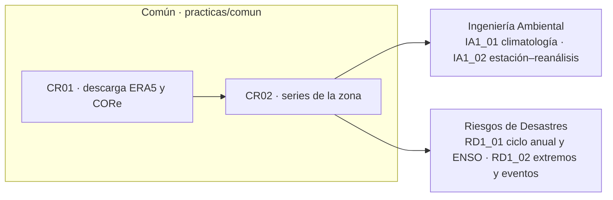

# practicas/

Cambio Climático se dicta en dos carreras con el mismo protocolo y enfoques distintos. Por eso las prácticas se organizan en dos capas:

```
practicas/
  comun/                  lo que hacen IGUAL las dos carreras: obtener y preparar los datos
    reanalisis/             CR01 descarga ERA5 y CORe · CR02 series de la zona
    estaciones/             formato común de datos de estación
    (satélite, modelos y escenarios: próximos cuadernos comunes)
  ambiental/              lo PROPIO de Ingeniería Ambiental (prácticas IA)
  riesgos-desastres/      lo PROPIO de Ingeniería en Riesgos de Desastres (prácticas RD)
```



## Reglas de la estructura

| | Común | Propio de cada carrera |
|---|---|---|
| Qué contiene | Descarga y preparación de datos: reanálisis, estaciones y, más adelante, satélite, modelos y escenarios | Análisis e interpretación con el enfoque de la carrera |
| Prefijo de los cuadernos | `CR` reanálisis, `CS` satélite, `CM` modelos, `CE` escenarios | `IA<práctica>_<paso>` Ambiental · `RD<práctica>_<paso>` Riesgos |
| Carpeta en el Drive del estudiante | `Mi unidad/CC_datos/<zona>/` (datos y series) | `Mi unidad/CC_Ambiental/practica-N/<zona>/` o `Mi unidad/CC_Riesgos/practica-N/<zona>/` |
| Material | `CC-COM-…` | `CC-IAM-…` · `CC-IRD-…` |
| Código | `herramientas/` (compartido por todo) | `herramientas/` |

Un estudiante descarga y prepara sus datos **una sola vez**, con los cuadernos comunes, y cada práctica de su carrera los lee desde `CC_datos/<zona>/`. Un cambio en la descarga se hace en un solo lugar y vale para las dos carreras.

## Cuadernos

| Capa | Cuaderno | Qué hace |
|---|---|---|
| Común | [](https://colab.research.google.com/github/crispaliz/cambio-climatico-espam/blob/main/practicas/comun/reanalisis/CR01_descarga_reanalisis.ipynb) `CR01_descarga_reanalisis` | ERA5 y CORe, diarios y mensuales, solo para la zona (opción A con su cuenta, u opción B desde el release) |
| Común | [](https://colab.research.google.com/github/crispaliz/cambio-climatico-espam/blob/main/practicas/comun/reanalisis/CR02_series_zona.ipynb) `CR02_series_zona` | Series diaria y mensual de la zona, ponderadas por área |
| Ambiental · P1 | [](https://colab.research.google.com/github/crispaliz/cambio-climatico-espam/blob/main/practicas/ambiental/practica-1/IA1_01_climatologia.ipynb) `IA1_01_climatologia` | Climatología 1995–2014 de las 9 variables |
| Ambiental · P1 | [](https://colab.research.google.com/github/crispaliz/cambio-climatico-espam/blob/main/practicas/ambiental/practica-1/IA1_02_estacion_vs_reanalisis.ipynb) `IA1_02_estacion_vs_reanalisis` | Contraste estación–reanálisis |
| Riesgos · P1 | [](https://colab.research.google.com/github/crispaliz/cambio-climatico-espam/blob/main/practicas/riesgos-desastres/practica-1/RD1_01_ciclo_anual_enso.ipynb) `RD1_01_ciclo_anual_enso` | Ciclo anual y compuestos por fase de ENSO |
| Riesgos · P1 | [](https://colab.research.google.com/github/crispaliz/cambio-climatico-espam/blob/main/practicas/riesgos-desastres/practica-1/RD1_02_extremos_eventos.ipynb) `RD1_02_extremos_eventos` | Índices de extremos y registro de eventos |
